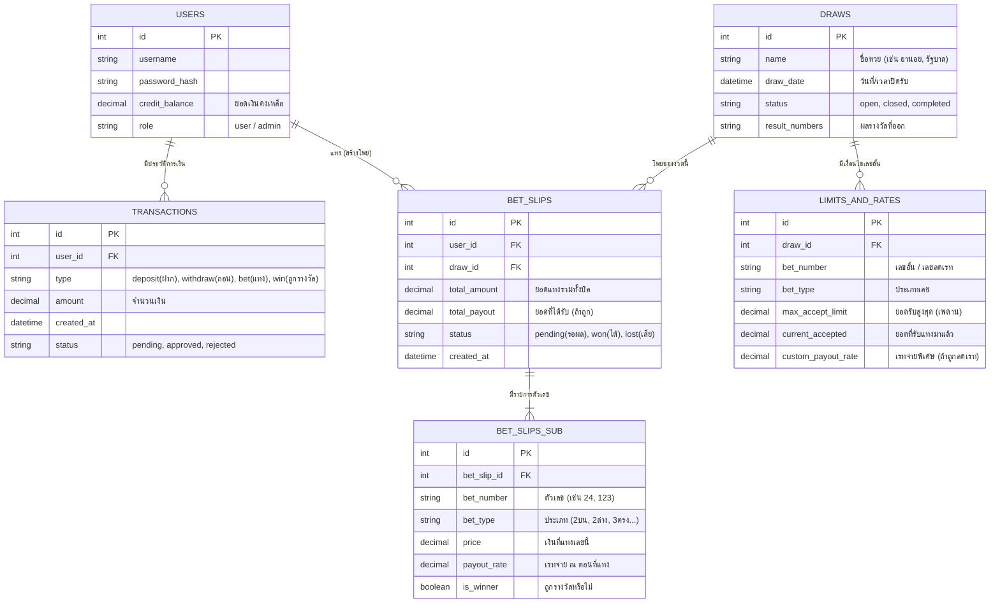

# โครงสร้างฐานข้อมูล (ER Diagram & Table Flow)

นี่คือแผนผังแสดงความสัมพันธ์ของตารางในระบบ (Entity-Relationship Diagram) ที่ออกแบบมารองรับระบบ 2 ตัว / 3 ตัวโดยเฉพาะ เพื่อให้ครอบคลุมทั้งเรื่องบิลเครดิต, การแทงแบบหลายเลขในบิลเดียว, และการจัดการเลขอั้นครับ

## คำอธิบายตารางและการทำงานเชื่อมต่อกัน

ระบบนี้ถูกออกแบบโดยแบ่งออกเป็น **6 ตารางหลัก** (ใน PostgreSQL) ดังนี้ครับ:

### 1. `USERS` (ตารางผู้ใช้และยอดเงิน)
*   **เก็บอะไร:** เก็บข้อมูลคนใช้งานและ **"ยอดเครดิตคงเหลือ (credit_balance)"**
*   **สำคัญยังไง:** เวลาลูกค้ากดคีย์เลขเสร็จ ระบบจะมาเช็คตารางนี้ว่าเงินพอไหม ถ้าพอถึงจะยอมให้สร้างโพย

### 2. `TRANSACTIONS` (ตารางกระเป๋าเงิน / บัญชี)
*   **เก็บอะไร:** ประวัติการเข้าออกของเงินทุกบาททุกสตางค์ (ฝาก, ถอน, หักเงินค่าแทง, รับเงินรางวัล)
*   **เชื่อมกับ USERS:** เพื่อบันทึกว่านาย A เติมเงินเข้ามาตอนไหนบ้าง (เก็บเป็นบัญชีแยก ห้ามลบเด็ดขาด)

### 3. `DRAWS` (ตารางรอบการออกรางวัล / งวด)
*   **เก็บอะไร:** งวดของหวย (เช่น ฮานอยรอบ 18:00น., รัฐบาล 1 ก.ย.) รวมไปถึงสถานะว่าเปิด/ปิดรับแทง และใช้สำหรับ **กรอกผลรางวัล**
*   **ทำงานยังไง:** เมื่อแอดมินมากรอกเลขผลรางวัลในตารางนี้ ระบบจะวิ่งไปเช็คตารางที่ 5 (`BET_SLIPS_SUB`) เพื่อแจกเงินอัตโนมัติ

### 4. `BET_SLIPS` (ตารางโพยหลัก)
*   **เก็บอะไร:** โพย 1 ใบ (สลิป) เก็บยอดรวมว่าบิลนี้แทงมา 1,000 บาท 
*   **เชื่อมกับ USERS & DRAWS:** เพื่อบอกว่าใครเป็นคนส่งโพยนี้ และส่งเข้ามาในงวดไหน

### 5. `BET_SLIPS_SUB` (ตารางรายการตัวเลขในโพย)
*   **เก็บอะไร:** ไส้ในของโพย 1 ใบ เช่น ในโพยใบเดียวอาจจะมีแทง 20 ตัวเลข ตารางนี้จะแตกข้อมูลออกมาว่ามีแทงเลข 24 (20 บาท), เลข 56 (100 บาท) เรทจ่ายตอนนั้นคือเท่าไหร่
*   **เชื่อมกับ BET_SLIPS:** เพื่อให้รู้ว่าตัวเลขเหล่านี้อยู่ในโพยไหน

### 6. `LIMITS_AND_RATES` (ตารางจัดการความเสี่ยงและเลขอั้น)
*   **เก็บอะไร:** ข้อมูลเลขอั้นและเพดานเงิน เช่น แอดมินตั้งว่า งวดนี้ (Draw ID) เลข 89 รับแค่ 10,000 บาท และจ่ายแค่ครึ่งราคา (45 บาท)
*   **เชื่อมกับ DRAWS:** เพื่อให้แอดมินกำหนดเลขอั้นแยกกันไปตามแต่ละงวดได้
*   *เทคนิคเพิ่มเติม:* ตัวเลขในช่อง `current_accepted` (ยอดที่รับมาแล้ว) จะถูกสำรองข้อมูลไว้บน **Redis** ด้วย เพื่อให้ระบบเช็คความเร็วแสงตอนที่ลูกค้ากำลังกด Numpad ว่าเลขนี้เต็มหรือยัง

---

## Data Dictionary (รายละเอียดฟิลด์ของแต่ละตารางแบบเจาะลึก)

เพื่อให้โปรแกรมเมอร์นำไปสร้างฐานข้อมูล (Database) ได้ทันที นี่คือรายละเอียดประเภทข้อมูล (Data Type) และหน้าที่ของแต่ละฟิลด์ครับ:

### 1. ตาราง `USERS` (ข้อมูลสมาชิก)
| ชื่อฟิลด์ (Field Name) | ประเภทข้อมูล (Data Type) | หน้าที่และคำอธิบาย |
| :--- | :--- | :--- |
| `id` | SERIAL (PK) | รหัสประจำตัวผู้ใช้งาน (รันตัวเลข 1,2,3... อัตโนมัติ) |
| `username` | VARCHAR(50) | ไอดีสำหรับล็อกอิน (ต้องไม่ซ้ำกัน) |
| `password_hash` | VARCHAR(255) | รหัสผ่าน (ต้องถูกเข้ารหัสไว้ ห้ามเก็บเป็น text ธรรมดา) |
| `credit_balance` | DECIMAL(12,2) | ยอดเงินเครดิตคงเหลือ (เก็บทศนิยม 2 ตำแหน่ง) |
| `role` | VARCHAR(20) | ระบุสิทธิ์ผู้ใช้ เช่น `user` (ลูกค้า), `admin` (เจ้าของ) |
| `created_at` | TIMESTAMP | วันเวลาที่สมัครสมาชิก |

### 2. ตาราง `TRANSACTIONS` (ประวัติบัญชีกระเป๋าเงิน)
| ชื่อฟิลด์ (Field Name) | ประเภทข้อมูล (Data Type) | หน้าที่และคำอธิบาย |
| :--- | :--- | :--- |
| `id` | SERIAL (PK) | รหัสรายการเดินบัญชี |
| `user_id` | INT (FK) | อ้างอิงว่ารายการนี้เป็นของลูกค้าคนไหน |
| `type` | VARCHAR(20) | ประเภทรายการ: `deposit` (ฝาก), `withdraw` (ถอน), `bet` (หักเงินแทง), `win` (ได้รางวัล), `cancel` (คืนเงินโพยยกเลิก) |
| `amount` | DECIMAL(12,2) | จำนวนเงินของรายการนั้นๆ |
| `balance_after` | DECIMAL(12,2) | **(สำคัญมาก)** ยอดเงินคงเหลือ "หลังจาก" ทำรายการนี้เสร็จสิ้น (ใช้ตรวจสอบบัญชีย้อนหลัง) |
| `status` | VARCHAR(20) | สถานะ: `pending` (รอแอดมินอนุมัติถอน), `approved` (สำเร็จ), `rejected` (ยกเลิก) |
| `created_at` | TIMESTAMP | วันเวลาที่ทำรายการ |

### 3. ตาราง `DRAWS` (งวดการออกรางวัล)
| ชื่อฟิลด์ (Field Name) | ประเภทข้อมูล (Data Type) | หน้าที่และคำอธิบาย |
| :--- | :--- | :--- |
| `id` | SERIAL (PK) | รหัสงวดการออกรางวัล |
| `name` | VARCHAR(100) | ชื่อของงวด เช่น "ฮานอยพิเศษ 1/9/26", "รัฐบาล 16 ก.ย." |
| `close_time` | TIMESTAMP | วันและเวลาที่ "ปิดรับแทง" (ระบบจะล็อคอัตโนมัติเมื่อถึงเวลานี้) |
| `status` | VARCHAR(20) | สถานะงวด: `open` (เปิดรับ), `closed` (ปิดรับแล้ว รอผล), `completed` (ออกผลและแจกเงินแล้ว) |
| `result_top` | VARCHAR(3) | ผลรางวัล "เลขบน" (รอแอดมินมากรอก) |
| `result_bottom` | VARCHAR(2) | ผลรางวัล "เลขอ่าง" (รอแอดมินมากรอก) |

### 4. ตาราง `BET_SLIPS` (โพย/บิลหลัก)
| ชื่อฟิลด์ (Field Name) | ประเภทข้อมูล (Data Type) | หน้าที่และคำอธิบาย |
| :--- | :--- | :--- |
| `id` | SERIAL (PK) | รหัสโพย (บิลที่ลูกค้าส่งเข้ามา) |
| `user_id` | INT (FK) | ลูกค้าคนไหนเป็นคนส่งโพยนี้ |
| `draw_id` | INT (FK) | โพยนี้แทงในงวดไหน |
| `total_amount` | DECIMAL(12,2) | รวมยอดเงินที่หักไปทั้งหมดในโพยนี้ |
| `total_payout` | DECIMAL(12,2) | ยอดรวมเงินรางวัลที่ได้รับจากโพยนี้ (ค่าเริ่มต้นคือ 0) |
| `status` | VARCHAR(20) | สถานะโพย: `pending` (รอลุ้นผล), `won` (ถูกรางวัล), `lost` (ไม่ถูก), `cancelled` (ยกเลิกโพยคืนเงิน) |
| `created_at` | TIMESTAMP | วันเวลาที่กดยืนยันส่งโพย |

### 5. ตาราง `BET_SLIPS_SUB` (รายการตัวเลขในโพย)
| ชื่อฟิลด์ (Field Name) | ประเภทข้อมูล (Data Type) | หน้าที่และคำอธิบาย |
| :--- | :--- | :--- |
| `id` | SERIAL (PK) | รหัสรายการย่อย |
| `bet_slip_id` | INT (FK) | อ้างอิงว่าเลขนี้อยู่ในโพยไหน |
| `bet_number` | VARCHAR(3) | ตัวเลขที่แทง (เช่น "89", "123", "4") |
| `bet_type` | VARCHAR(20) | ประเภทการแทง เช่น `2_top` (2ตัวบน), `2_bottom` (2ตัวล่าง), `3_direct` (3ตัวตรง), `3_toad` (3ตัวโต๊ด), `run_top` (วิ่งบน) |
| `price` | DECIMAL(12,2) | จำนวนเงินที่แทงในเลขนี้ |
| `payout_rate` | DECIMAL(8,2) | อัตราจ่าย (เรท) ณ วินาทีที่ลูกค้ากดแทง (สำคัญมาก เพราะเรทอาจเปลี่ยนตามเลขอั้น) |
| `is_winner` | BOOLEAN | สถานะว่าเลขตัวนี้ถูกรางวัลหรือไม่ (`true`/`false`) |
| `payout_amount` | DECIMAL(12,2) | เงินที่ได้จากเลขนี้ตัวเดียว (คำนวณจาก `price * payout_rate`) |

### 6. ตาราง `LIMITS_AND_RATES` (การจัดการเลขอั้น / เลขเต็ม)
| ชื่อฟิลด์ (Field Name) | ประเภทข้อมูล (Data Type) | หน้าที่และคำอธิบาย |
| :--- | :--- | :--- |
| `id` | SERIAL (PK) | รหัสตั้งค่า |
| `draw_id` | INT (FK) | อ้างอิงว่าเลขอั้นนี้เป็นของงวดไหน |
| `bet_number` | VARCHAR(3) | เลขที่ต้องการอั้น หรือจำกัดยอดรับ (เช่น "69") |
| `bet_type` | VARCHAR(20) | ประเภทเลขที่ต้องการอั้น (เช่น `2_bottom` หรือถ้าอั้นทุกประเภทอาจจะใส่เป็น `all`) |
| `max_accept_limit`| DECIMAL(12,2) | ยอดรับแทงสูงสุด (เช่น ตั้งไว้ 10,000 บาท ถ้าเกินกว่านี้ ระบบจะปิดรับเลขนี้อัตโนมัติ) |
| `current_accepted`| DECIMAL(12,2) | ยอดที่มีคนแทงเข้ามาแล้วทั้งหมดของเลขนี้ |
| `custom_payout_rate`| DECIMAL(8,2) | ถ้าไม่อยากปิดรับ แต่ต้องการ "ลดเรทจ่าย" (จ่ายครึ่งราคา) ให้มากำหนดเรทใหม่ในช่องนี้ |
